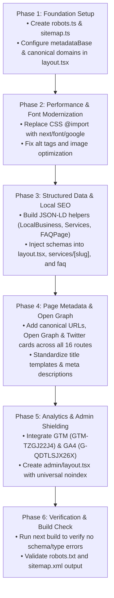

# Comprehensive Technical SEO Audit Report
**Target Website:** `https://kobbysintertechservices.online`  
**Business Name:** Kobby’s Intertech Services (Achimota, Accra, Ghana)  
**Audit Scope:** Next.js Frontend Codebase (`apps/web`)  
**Status:** Audit Complete · **No code files have been modified** (Awaiting approval).

---

## A. Project Architecture & Next.js Configuration

| Component | Current Implementation | Assessment |
| :--- | :--- | :--- |
| **Framework & Version** | Next.js `16.4.2` | Modern Next.js version supporting modern App Router conventions, metadata streaming, and server components. |
| **Runtime & React** | React `19.3.0` & React DOM `19.3.0` | React 19 Server Components paradigm. |
| **Routing Paradigm** | App Router (`apps/web/src/app`) | Modern directory-based App Router architecture with route handlers (`/api/admin/...`) and dynamic segments (`/services/[slug]`). |
| **CSS & Styling** | Tailwind CSS v4 (`@tailwindcss/turbopack`) | High-performance CSS engine. |
| **Font Delivery** | CSS `@import` in `globals.css` | ⚠️ **Issue:** Blocks initial rendering (see Section D). |
| **Next.js Config** | `apps/web/next.config.ts` | Allows LAN dev origins, Cloudflare R2 image remote patterns, and API rewrites to NestJS backend (`/api/v1/:path*`). Missing canonical host redirects and `trailingSlash` handling. |
| **Deployment Platform** | Vercel | Edge routing, automatic SSL, and Brotli compression enabled. |

### Public Routes Audited:
1. `/` (Homepage)
2. `/about` (About Us, Mission, Values)
3. `/services` (Service Catalog Index)
4. `/services/cctv-security` (CCTV Installation & Security Systems)
5. `/services/fibre-internet` (Fibre Optic & Satellite Internet)
6. `/services/networking` (Structured Cabling & Networking)
7. `/services/satellite` (Satellite Television Installation)
8. `/services/electrical-works` (Electrical Installation & Maintenance)
9. `/services/gps-tracking` (GPS Vehicle Tracking & Fleet Management)
10. `/gallery` (Project Showcase)
11. `/contact` (Contact Hub & Inquiry Form)
12. `/faq` (Frequently Asked Questions)
13. `/book-service` (Service Booking Engine)
14. `/request-quote` (Itemised Quotation Request)
15. `/privacy` (Privacy Policy under Ghana Act 843)
16. `/terms-of-service` (Terms of Service)

---

## B. Existing SEO Implementation (Already Correct)

1. **Native App Router Metadata API**:
   - The application does not use deprecated `<head>` or `next/head` tags; it relies on Next.js `Metadata` objects and `generateMetadata` exports.
2. **Dynamic Static Generation**:
   - `apps/web/src/app/services/[slug]/page.tsx` implements `generateStaticParams()`, prerendering all 6 service pages at build time for optimal server response time (TTFB).
3. **Responsive Mobile Viewport**:
   - `apps/web/src/app/layout.tsx` correctly defines `export const viewport: Viewport`, preventing responsive scaling glitches on mobile devices.
4. **NAP (Name, Address, Phone) Data Consistency**:
   - Across header, footer, contact hub, and legal documents, business information is consistent:
     - **Name:** Kobby's Intertech Services
     - **Phone:** `+233 24 348 7160` (clickable via `tel:+233243487160`)
     - **Email:** `kobbysintertech@gmail.com` (clickable via `mailto:`)
     - **Base Location:** Achimota, Accra, Ghana
5. **Robust Internal Linking & Navigation**:
   - `SiteHeader` provides direct links to all 6 service landing pages in a dedicated dropdown and mobile drawer.
   - `SiteFooter` reinforces crawl depth with complete links to services, legal pages, contact, and quick links.
   - Cross-linking between related services is implemented on each `/services/[slug]` page (`otherServices.slice(0, 3)`).
6. **User Retention 404 Handler**:
   - `apps/web/src/app/not-found.tsx` features 6 direct links to popular destinations (CCTV, Fibre, Technician Booking, Quote Request, Gallery, FAQ), preserving crawl paths for disconnected URLs.
7. **High Conversion Architecture**:
   - Direct WhatsApp links with contextual URL-encoded pre-filled messages on every service page.
   - Fast-action on-site technician booking and quote request forms.

---

## C. Missing SEO Requirements

### 1. Missing `robots.txt`
- **Location:** Neither `apps/web/src/app/robots.ts` nor `apps/web/public/robots.txt` exists.
- **Problem:** Search engine bots hitting `https://kobbysintertechservices.online/robots.txt` encounter a 404. Crawlers have no explicit directive to discover the sitemap, and sensitive admin routes (`/admin/`, `/gallery/manage`, `/api/`) are not protected at the crawler directive level.

### 2. Missing XML Sitemap (`sitemap.xml`)
- **Location:** Neither `apps/web/src/app/sitemap.ts` nor `apps/web/public/sitemap.xml` exists.
- **Problem:** Search engines (Google Search Console, Bing Webmaster Tools) cannot consume an official XML sitemap index. URLs, priority weightings, and `lastModified` timestamps must be inferred solely via HTML scraping.

### 3. Missing `metadataBase` Configuration
- **Location:** `apps/web/src/app/layout.tsx`
- **Problem:** Without `metadataBase: new URL('https://kobbysintertechservices.online')`, Next.js throws build warnings and cannot resolve relative paths for Open Graph images, Twitter cards, or canonical alternate tags.

### 4. Missing Canonical Tag Implementation (`alternates.canonical`)
- **Location:** `layout.tsx` and all page routes (`page.tsx`, `services/[slug]/page.tsx`, etc.).
- **Problem:** No pages declare `<link rel="canonical" href="...">`. If URLs are accessed with tracking queries (e.g. `?service=cctv`, `?utm_source=...`) or accessed via `www.` vs non-`www.`, search engines can treat them as duplicate content and split page authority.

### 5. Missing Open Graph & Twitter/X Social Sharing Metadata
- **Location:** All routes (`layout.tsx`, `about/page.tsx`, `services/[slug]/page.tsx`, etc.).
- **Problem:** No Open Graph tags (`og:title`, `og:description`, `og:image`, `og:url`, `og:site_name`, `og:locale`, `og:type`) or Twitter card tags (`twitter:card`, `twitter:image`) are specified. When customers or prospects share website links on WhatsApp, LinkedIn, or Facebook, links appear plain without an engaging image card preview.

### 6. Missing Structured Data (Schema.org / JSON-LD)
- **Location:** Entire frontend.
- **Problem:** No JSON-LD structured data scripts exist. The site misses the following rich search results:
  - **`LocalBusiness` / `HomeAndConstructionBusiness` / `ProfessionalService`**: Missing crucial geo-coordinates, address (Achimota, Accra), opening hours, phone, and service area (Greater Accra, Ashanti Region, Ghana). This is vital for local 3-pack rankings in Google Maps & Local Search.
  - **`Service` & `Offer` Schema**: Missing on `/services/[slug]` to explain service type, provider, and coverage area to search bots.
  - **`FAQPage` Schema**: Missing on `/faq`. Google displays collapsible FAQ accordions directly in SERPs when `FAQPage` JSON-LD is provided.
  - **`WebSite` & `Organization` Schema**: Missing sitewide search and official corporate entity definition.
  - **`BreadcrumbList` Schema**: Missing on service subpages to show hierarchical breadcrumbs in Google search snippets.

### 7. Missing Google Analytics 4 (GA4) & Google Tag Manager (GTM)
- **Location:** `apps/web/src/app/layout.tsx`
- **Problem:** The container `GTM-TZGJ22J4` and GA4 Measurement ID `G-QDTLSJX26X` provided in the audit brief are completely absent from the codebase. User interactions, bookings, WhatsApp click-throughs, and page views are not currently tracked in GA4/GTM.

### 8. Missing Homepage Targeted SEO Metadata
- **Location:** `apps/web/src/app/page.tsx`
- **Problem:** `page.tsx` does not export an independent `metadata` object, falling back to `layout.tsx`'s generic description: *"Technology, security and communication solutions across Ghana."* The homepage lacks geo-targeted keywords (e.g., "CCTV, Fibre Internet, Networking & Electrical Installation in Accra, Ghana").

---

## D. Incorrect or Problematic Implementations

### 1. Render-Blocking Google Fonts `@import`
- **File:** `apps/web/src/app/globals.css` (Line 1)
- **Code:**
  ```css
  @import url('https://fonts.googleapis.com/css2?family=Playfair+Display:ital,wght@0,600;0,700;1,600&family=Plus+Jakarta+Sans:wght@400;500;600;700&display=swap');
  ```
- **Issue:** Using CSS `@import` triggers a serial network waterfall: browser downloads `globals.css` -> discovers `@import` -> requests Google Fonts stylesheet -> downloads `.woff2` files. This harms Core Web Vitals (First Contentful Paint and Largest Contentful Paint).
- **Remedy:** Migrate to Next.js native `next/font/google` in `layout.tsx`, which self-hosts fonts locally with zero layout shift (CLS) and zero runtime external HTTP requests.

### 2. Heading Level Jumps (Hierarchy Inconsistencies)
- **File:** `apps/web/src/app/services/[slug]/page.tsx` (Line 73)
  - `HeroSection` renders `<h1>{service.name}</h1>`.
  - The immediately following advisory ribbon renders:
    ```tsx
    <h4>Need Immediate Advice for {service.name}?</h4>
    ```
  - **Issue:** Skips levels `<h2>` and `<h3>`, violating WCAG accessibility and heading hierarchy semantics.
- **File:** `apps/web/src/components/contact-hub.tsx` (Lines 107, 145, 168)
  - Values inside contact cards (`+233 24 348 7160`, `kobbysintertech@gmail.com`, `Achimota, Accra–Ghana`) are marked as `<h2>`.
  - **Issue:** Section titles should describe content (e.g., "Direct Call & WhatsApp", "Email Inquiries"); using raw contact values as headings fragments page structure.
- **File:** `apps/web/src/components/home-gallery-carousel.tsx` (Line 253)
  - The Project Showcase section header uses a styled `<span>` rather than a semantic `<h2>`.

### 3. CSS Background Images Bypassing Search Indexing & Image Optimization
- **File:** `apps/web/src/app/page.tsx` (Line 73)
  ```tsx
  <span className="svc-card-img" style={{ backgroundImage: `url(${service.image})` }} aria-hidden="true" />
  ```
- **Issue:** Images rendered via inline CSS `background-image` cannot be indexed by Google Image Search, and Next.js automatic WebP/AVIF compression and responsive `srcset` generation cannot process them.

### 4. Empty Alt Attribute on Header Logo
- **File:** `apps/web/src/components/site-header.tsx` (Line 67)
  ```tsx
  <Image src="/brand/logo.png" alt="" width={42} height={42} priority />
  ```
- **Issue:** An empty `alt=""` marks the brand logo as purely decorative. It should have a descriptive alt tag: `alt="Kobby's Intertech Services Logo"`.

### 5. Incomplete Crawler Directives on Private Admin Routes
- **Files:**
  - `apps/web/src/app/admin/page.tsx` (Dashboard)
  - `apps/web/src/app/admin/gallery/page.tsx` (Photo Management)
  - `apps/web/src/app/admin/team/page.tsx` (Team Management)
  - `apps/web/src/app/gallery/manage/page.tsx` (Legacy Gallery Manager)
- **Issue:** While `/admin/login`, `/admin/account`, and `/admin/bookings` declare `robots: { index: false, follow: false }`, the dashboard, team, and gallery admin pages omit it. Combined with the absence of a `robots.txt` disallow rule, search engine bots could attempt to crawl and index private URL fragments.

### 6. Title Template Absence in Root Layout
- **File:** `apps/web/src/app/layout.tsx` (Line 8)
- **Issue:** Currently defines a hardcoded string `title: "Kobby's Intertech Services | ..."`. Every subpage currently manually concatenates `| Kobby's Intertech Services`.
- **Best Practice:** Use Next.js title template:
  ```ts
  title: {
    default: "Kobby's Intertech Services | Technology, Security & Connectivity in Ghana",
    template: "%s | Kobby's Intertech Services",
  }
  ```

---

## E. Recommended Improvements

### 1. Dynamic `robots.ts`
Implement standard Next.js `apps/web/src/app/robots.ts` returning:
```ts
import type { MetadataRoute } from 'next';

export default function robots(): MetadataRoute.Robots {
  return {
    rules: [
      {
        userAgent: '*',
        allow: '/',
        disallow: ['/admin/', '/gallery/manage/', '/api/'],
      },
    ],
    sitemap: 'https://kobbysintertechservices.online/sitemap.xml',
    host: 'https://kobbysintertechservices.online',
  };
}
```

### 2. Dynamic XML `sitemap.ts`
Implement `apps/web/src/app/sitemap.ts` dynamically combining:
- Static routes (`/`, `/about`, `/services`, `/gallery`, `/contact`, `/faq`, `/book-service`, `/request-quote`, `/privacy`, `/terms-of-service`) with appropriate change frequencies and priority scores.
- Dynamic routes (`/services/${slug}`) mapped directly from `services` in `@/data/site`.

### 3. Comprehensive JSON-LD Structured Data
Create modular JSON-LD generators in a helper utility (e.g., `@/lib/schema-org.ts`):
1. **`LocalBusiness` / `HomeAndConstructionBusiness` Schema** embedded in `layout.tsx`:
   - Name, Legal Name, URL, Logo, Telephone (`+233 24 348 7160`), Email, PriceRange (`GH₵ / $$$`).
   - Address (`Achimota, Accra, Greater Accra, Ghana`).
   - Geo-coordinates for Achimota (`latitude: 5.6128`, `longitude: -0.2244`).
   - Opening Hours (`Mo-Sa 07:30-17:00`).
   - Service Area: Greater Accra Region, Ashanti Region, Ghana.
2. **`Service` Schema** on `/services/[slug]`:
   - Specific service name, description, provider, service area, and offers.
3. **`FAQPage` Schema** on `/faq`:
   - Mapped directly from `FAQ_ITEMS` to generate Google accordion rich snippets.
4. **`BreadcrumbList` Schema** on all subpages.

### 4. Canonical & Open Graph Metadata Expansion
1. Set `metadataBase: new URL('https://kobbysintertechservices.online')` in `layout.tsx`.
2. Configure default `openGraph` and `twitter` objects in `layout.tsx` with default banner, locale `en_GH`, site name, and type `website`.
3. Add specific Open Graph images and canonical tags (`alternates: { canonical: ... }`) to every public route.

### 5. Core Web Vitals Optimization (Font Migration)
Replace the `@import` in `globals.css` with `next/font/google` in `layout.tsx`:
- `Plus_Jakarta_Sans` for body text.
- `Playfair_Display` for editorial accents.
- Self-hosted by Next.js automatically at build time, eliminating layout shifts and external font network requests.

### 6. Google Tag Manager & Google Analytics 4 Setup
Add Next.js `@next/third-parties/google` or standard Next.js `<Script>` tags in `layout.tsx`:
- GTM Container: `GTM-TZGJ22J4`
- GA4 Measurement: `G-QDTLSJX26X`

---

## F. Files That Will Need Modification

| File Path | Action | Scope of Change |
| :--- | :--- | :--- |
| `apps/web/src/app/robots.ts` | **Create** | Generate dynamic `robots.txt` disallowing `/admin/`, `/gallery/manage/`, `/api/` and linking to sitemap. |
| `apps/web/src/app/sitemap.ts` | **Create** | Generate dynamic XML sitemap covering all 16 public and service routes. |
| `apps/web/src/lib/schema-org.ts` | **Create** | Helper functions to generate JSON-LD for LocalBusiness, Services, FAQPage, and Breadcrumbs. |
| `apps/web/src/app/layout.tsx` | **Modify** | Add `metadataBase`, title template, canonical base, OpenGraph/Twitter defaults, GTM/GA4 scripts, and `next/font/google` loading. |
| `apps/web/src/app/globals.css` | **Modify** | Remove render-blocking `@import` for Google Fonts. |
| `apps/web/src/app/page.tsx` | **Modify** | Add targeted homepage metadata, canonical tag, and replace CSS background images with optimized `<Image>` components where suitable. |
| `apps/web/src/app/services/[slug]/page.tsx` | **Modify** | Add canonical tag, Open Graph metadata, Service JSON-LD schema, and fix `<h4>` heading level jump. |
| `apps/web/src/app/faq/page.tsx` | **Modify** | Add canonical tag, Open Graph metadata, and `FAQPage` JSON-LD schema. |
| `apps/web/src/app/about/page.tsx` | **Modify** | Add canonical URL and Open Graph metadata. |
| `apps/web/src/app/contact/page.tsx` | **Modify** | Add canonical URL and Open Graph metadata. |
| `apps/web/src/app/gallery/page.tsx` | **Modify** | Add canonical URL and Open Graph metadata. |
| `apps/web/src/app/book-service/page.tsx` | **Modify** | Add canonical URL and Open Graph metadata. |
| `apps/web/src/app/request-quote/page.tsx` | **Modify** | Add canonical URL and Open Graph metadata. |
| `apps/web/src/app/privacy/page.tsx` | **Modify** | Add canonical URL and Open Graph metadata. |
| `apps/web/src/app/terms-of-service/page.tsx` | **Modify** | Add canonical URL and Open Graph metadata. |
| `apps/web/src/app/admin/layout.tsx` | **Create** | Set `robots: { index: false, follow: false }` universally across all current and future `/admin/*` routes. |
| `apps/web/src/components/site-header.tsx` | **Modify** | Add descriptive `alt="Kobby's Intertech Services Logo"` to brand logo. |
| `apps/web/src/components/contact-hub.tsx` | **Modify** | Adjust card value tags to semantic paragraphs/divs to normalize heading hierarchy. |

---

## G. Proposed Implementation Sequence



---

## H. Potential Risks & Precautions

1. **Hydration Mismatch Risk**:
   - *Risk:* Injecting raw JSON-LD `<script type="application/ld+json">` without sanitization or inside client components can cause hydration warnings.
   - *Precaution:* Render JSON-LD scripts exclusively in Server Components using `JSON.stringify()` within standard script tags with `dangerouslySetInnerHTML={{ __html: JSON.stringify(...) }}`.
2. **Font Loading & Cumulative Layout Shift (CLS)**:
   - *Risk:* Migrating from `@import` to `next/font/google` could cause font-swap jumps or mismatch font variable names used by Tailwind CSS.
   - *Precaution:* Map CSS variables (`--font-playfair`, `--font-jakarta`) cleanly in `layout.tsx` and verify body class application without changing computed typography styles.
3. **Canonical Loop / WWW vs Non-WWW Conflict**:
   - *Risk:* If canonicals point to `https://kobbysintertechservices.online` while Vercel's primary domain is set to `www.kobbysintertechservices.online`, search engines will see mixed signals.
   - *Precaution:* Maintain consistent canonical URL formatting using `https://kobbysintertechservices.online` across all tags, sitemaps, and schemas as requested in the audit specification.
4. **Zero Design or Layout Disruption**:
   - *Risk:* Altering heading tags or removing CSS `@import` could accidentally modify visual font sizes or line heights.
   - *Precaution:* Retain all existing CSS class names (`contact-main-value`, `service-section-title`, etc.) when correcting semantic tags, preserving 100% of the UI design and layout.

---

## Audit Summary: Current vs. Target State

| Feature | Current State | Required Target State |
| :--- | :---: | :---: |
| **robots.txt** | ❌ Missing (404) | ✅ Dynamic `robots.ts` with disallow rules & sitemap |
| **XML Sitemap** | ❌ Missing (404) | ✅ Dynamic `sitemap.ts` covering all routes |
| **metadataBase** | ❌ Missing | ✅ Configured to `https://kobbysintertechservices.online` |
| **Canonical URLs** | ❌ Missing on all pages | ✅ Implemented on all 16 public routes |
| **Open Graph (Social Cards)** | ❌ Missing on all pages | ✅ Complete OG tags on all public routes |
| **Twitter / X Cards** | ❌ Missing on all pages | ✅ Summary with Large Image cards configured |
| **LocalBusiness Schema** | ❌ Missing | ✅ LocalBusiness JSON-LD with Accra NAP & geo |
| **Service Schema** | ❌ Missing | ✅ Service & Offer JSON-LD on all 6 service routes |
| **FAQPage Schema** | ❌ Missing | ✅ FAQPage JSON-LD on `/faq` for Google accordions |
| **Google Tag Manager** | ❌ Missing (`GTM-TZGJ22J4`) | ✅ Integrated via Next.js Third Parties / Script |
| **Google Analytics 4** | ❌ Missing (`G-QDTLSJX26X`) | ✅ Integrated with GA4 measurement |
| **Google Fonts Delivery** | ⚠️ Blocking CSS `@import` | ✅ Optimized `next/font/google` self-hosting |
| **Admin Route Protection** | ⚠️ Partial meta noindex | ✅ Universal `admin/layout.tsx` noindex + robots.txt |
| **Heading Hierarchy** | ⚠️ Advisory `<h4>` jump | ✅ Strict semantic H1 -> H2 -> H3 hierarchy |

---

> [!IMPORTANT]
> **No changes have been made yet.** In accordance with the audit guidelines, execution is paused here. Whenever you are ready, let me know and I will proceed with implementing the recommendations step by step.